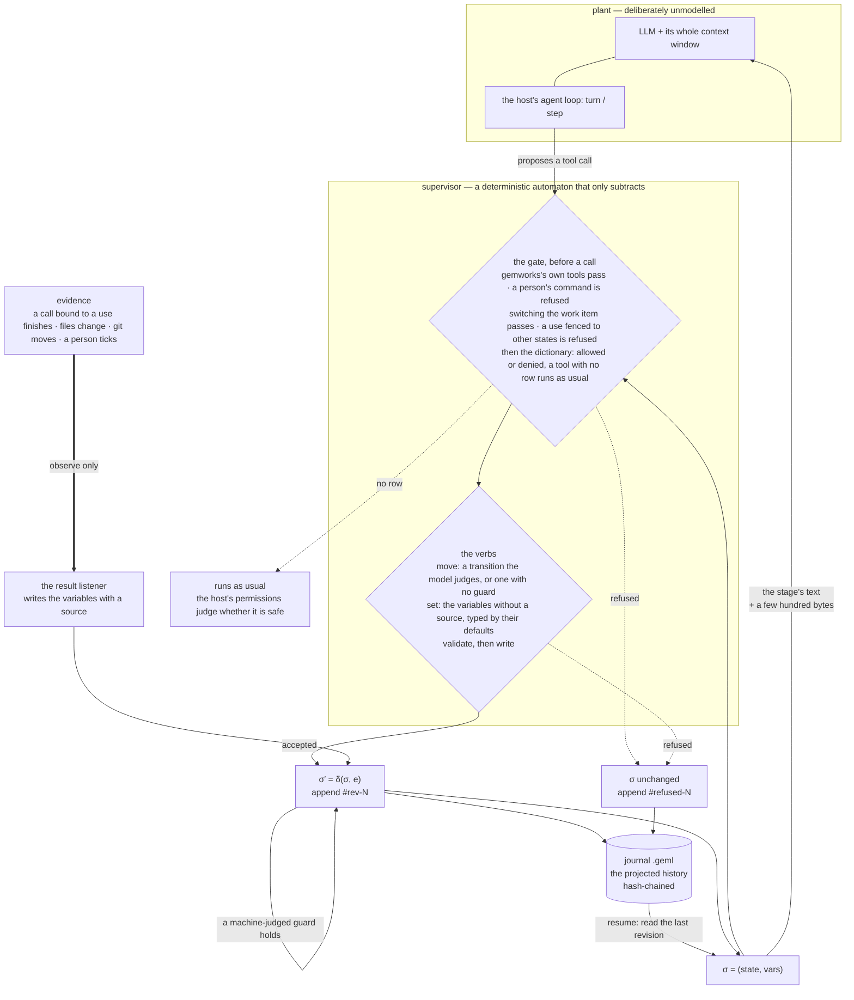

# Going further: how a strict flow keeps the model in line

[← Back to README](../README.md)

A **workflow written in GEML** — one statechart — decides, at every moment,
which transitions an agent may take, which variables it may write, and which
tools belong to the stage it is in. A state declares **uses** (`edit`, `test`,
`deploy-prod`: words the author picks); a **tool dictionary** beside the
workflow binds each use to this project's tools, and a use the workflow
declares as a **rule** is usable only in the states that declare it. **Evidence** — a test's exit status, a pull request,
a file on disk, a person's tick — is written from what the host observed, never
from the model's word. Every change is validated before it lands and appended
to a **hash-chained journal** — itself an ordinary GEML document you can read,
address, diff and verify.

This is not a model of the agent. It is a **supervisor** in the
Ramadge–Wonham sense: the agent (an LLM plus its whole context) is the plant,
left unmodelled; the supervisor runs beside it and only ever *removes* events
from what may happen next. What it buys you is a safety property — certain
action sequences cannot occur — not convergence, and not a prediction of what
the model will do.



Only the mechanism is the host's; every decision above is one module
(`src/core/supervisor.ts`) that no host has a copy of — on Claude Code it runs
in the bundled CLI, which the plugin asks over a bridge:

| | DeepSeek Harness | pi agent | Claude Code |
|---|---|---|---|
| the gate before a call | `tools/pre-execute`: allow, or deny with the reason | `tool_call` → `{ block, reason }`, or nothing | a `tool.call` hook: the fast path decides from the policy it holds, the CLI judges and records over the bridge; the preferred-tool question goes to the person with `$.ui.ask`, the answer into `tools.geml`, and the dictionary's default parameters fill in what the call left out |
| the verbs' shape | `move` and `set` are re-registered per state: `move`'s enum is the transitions the model may take, `set`'s parameters the variables it may write; `status` is always there | registered once per session: `move`'s enum is every target in the workflow; a move that is not a transition out of the state is refused and recorded | static schemas (`to` is any string); a move that is not a transition out is refused |
| a person's transition | the board in the web GUI, a tab in the right sidebar: a person's transition — one marked `approval` included — a tick, a hold; the session's journal is not the CLI's, so `gemworks advance` in a terminal does not reach it | not yet: a session's journal is not the CLI's, so a transition marked `approval` has no one to take it there | the board, or `gemworks advance` in a terminal; `gemworks mark` ticks a variable whose source is a person |
| evidence | `tool`, from `tools/result`: a command's exit status when the result reports one, else 1 for an error and 0 for a clean result | `tool`, from `tool_result`: an error reads as exit 1, a clean result as 0 | `tool`, `file`, `git` and `human`, through the workspace |
| σ reaches the model | a prompt section + a per-step context block | the system prompt, rebuilt once per user turn | the new `#current` on the result of the call that moved the stage, else on the next prompt |
| the journal | `<journalDir>/<session>.geml` | the same file, plus one session entry per block — which is what makes a forked session inherit the chain | `.geml/journals/<item>.geml`, one per work item, shared with the CLI |
| `.geml/context.geml` | not written | not written | written |

The supervisor's state is `σ = (state, vars)`, and the allowed set is one line:

> `A(σ)` = every tool but those bound to a rule this state does not declare and
> those the dictionary denies in this state, ⋃ the transitions out whose guard
> the model judges or that have none, ⋃ the variables without a source.

A tool bound to a rule this state does not declare is refused, and so is one
the dictionary denies in this state; every other tool runs as usual.

## Status

| | |
|---|---|
| Shipping now | The workflow format, on `geml-statechart/v1` (no vocabulary of its own); the core library (workflow loading and static checks, the tool dictionary, evidence by source, hash-chained revisions, journal render/read/verify, the supervisor, Stagehand, work items, the backlog table); the workspace, which runs one locked operation at a time against a project; the `gemworks` CLI; four bundled strict flows (`coding`, `dev`, `matter`, `video`), each with its dictionary; a Claude Code plugin (the band above the prompt, the board, `/gemworks`, and the model's tools: `status`, `move`, `set` for a strict flow, `work`, `note`, `practice`, `propose`, `ask`, `artifact` and `rule` for the work loop); `gemworks mcp` for hosts that speak only MCP; Codex and Antigravity hooks, with the GEML board page `.geml/board.geml`; and both host adapters — a Cordis plugin for DeepSeek Harness `0.2.0-rc.2` with the board as a tab in its web GUI, and an extension for pi agent `1.x`. |
| Tested without a model | Every gate, on both adapter hosts: the DSH adapter against a real agent from `dsh-agent-loop-testkit`, the pi agent adapter against a double that runs its own pipeline order and its own argument validator. The Claude Code plugin: its hooks module under `claude plugin test`, in real event order, with a scripted bridge; the bridge through the bundled CLI in throwaway git repositories, with a stand-in for `gh`; the fast path held to what the workspace would refuse, record and ask about. A run against a live model is a manual step, below. |
| Not on every host yet | Evidence from files, git and a person, and the stage's context document (`.geml/context.geml`), run through the workspace. The Claude Code plugin hands it every tool call, and so do Codex's hooks once trusted, so all four sources are read there. On MCP-only hosts (`gemworks mcp`: Gemini CLI, Grok, Codex with its hooks untrusted, …) no tool call is seen: `tool` evidence is never written, nothing is refused, and `status` reads git and the file variables afresh when the model calls it. The two host adapters keep one journal per session and write `tool` evidence only; on pi agent a transition marked `approval` has no one to take it yet. |
| Not yet measured | What re-registering `move` and `set` per state costs DeepSeek Harness's prompt cache. |
| Also in this bundle | The GEML MCP server and four skills under `host-skills/` — `geml`, `geml-code-graph`, `gemworks-mcp` and `split-session` (see [Install](hosts.md#install)). |

Design: [`docs/design/specs/2026-10-11-gemworks-design.md`](../docs/design/specs/2026-10-11-gemworks-design.md).
The workflow format and runtime rules: [`spec/workflow.md`](../spec/workflow.md);
the statechart format: [`spec/profiles/geml-statechart/`](https://github.com/geml-spec/geml/blob/main/spec/profiles/geml-statechart/geml-statechart-profile.md) in the GEML repository.

## A workflow

This is the workflow `gemworks init` writes, abridged — the one that governs a
coding session. A workflow is one `diagram` block whose body is a statechart:

```geml
=== meta
title   = "Coding workflow"
profile = "geml-statechart/v1"
===

=== diagram {#flow format=geml-statechart caption="Coding workflow"}
{
  "initial": "explore",
  "states": {
    "explore":   { "title": "Explore",   "description": "Read the code before proposing anything; record goal and touched, then move to plan.", "prompt": "#explore" },
    "plan":      { "title": "Plan",      "description": "Write the plan down before touching a file.", "prompt": "#plan" },
    "implement": { "title": "Implement", "description": "Make the change. Editing is possible here and nowhere else.", "prompt": "#implement", "rules": ["edit"] },
    "verify":    { "title": "Verify",    "description": "Run the command; its exit status is the evidence.", "prompt": "#verify", "rules": ["test"] },
    "review":    { "title": "Review",    "description": "Hand back to the person.", "prompt": "#review" },
    "done":      { "title": "Done", "final": true }
  },
  "vars": {
    "goal":       { "default": "", "note": "What this change is supposed to achieve, in one sentence" },
    "touched":    { "default": "", "note": "The files this change edits, space separated" },
    "plan":       { "default": "", "note": "The steps, written before any file is touched" },
    "command":    { "default": "", "note": "The command that decides whether this works, e.g. npm test" },
    "tests-pass": { "default": false, "source": { "tool": "test" } }
  },
  "transitions": [
    { "from": "explore",   "to": "plan",      "guard": "goal and touched are recorded" },
    { "from": "plan",      "to": "implement", "guard": "plan and command are recorded" },
    { "from": "implement", "to": "verify",    "note": "The edit is made; go run the command." },
    { "from": "verify",    "to": "implement", "guard": "the command failed, or the change is not finished", "actions": [{ "reset": ["tests-pass"] }] },
    { "from": "verify",    "to": "review",    "guard": { "properties": { "tests-pass": { "const": true } } } },
    { "from": "review",    "to": "done",      "approval": true },
    { "from": "review",    "to": "implement", "guard": "the person asked for changes", "actions": [{ "reset": ["tests-pass"] }] }
  ]
}
===

## Explore {#explore}

Read the code before proposing anything. …
```

and the project's `.geml/tools.geml` — the dictionary that binds the uses to
this project's tools, one for all its workflows:

```geml
=== table {#tools}
| tool             | for  | allow | deny | default | params |
|------------------|------|-------|------|---------|--------|
| Read             |      | *     |      |         |        |
| Grep             |      | *     |      |         |        |
| Edit             | edit |       |      | yes     |        |
| Write            | edit |       |      |         |        |
| Bash(npm test)   | test |       |      | yes     |        |
| Bash(cargo test) | test |       |      |         |        |
===
```

The states run `#explore → #plan → #implement → #verify → #review → #done`.
Three kinds of guard, three judges: an object over the variables (a JSON
Schema subset) is the machine's, and such a transition is taken on its own the
moment its guard holds — `tests-pass` written true takes `#verify` to
`#review`; a sentence is the model's, taken with `move` when the model judges
it true; `approval: true` is a person's, taken on the board or with
`gemworks advance`, never by the model. A guard holds whoever moves the
workflow. A variable with a `source` is evidence: `tests-pass` is written from
the exit status of a call bound to the use `test`, and `set` refuses it. A
variable without one is the model's to `set`, typed by its default.
`{ "elapsed": "PT2H" }` reads the clock: true once the stage has been held
that long, so a guard on it is a timeout. `done`
is marked `final`: a work item that enters it is closed — no transition out,
no evidence expiring — and a person's `gemworks rollback` reopens it.

A use a state declares under `rules` is usable only in the states that declare
it; one a state lists under `tools` runs anywhere, and its evidence counts only
where it is declared. `#implement` declares the rule
`edit`, so `Edit` and `Write` run there and are refused everywhere else
(`Write is edit, which is used only in #implement; the workflow is in
#explore`); `#verify` declares `test`, so `npm test` runs there and nowhere
else. A tool the dictionary has no row for runs as usual. On a Rust project the same workflow binds `test`
to `cargo test` and changes nothing else. None of that is a rule in a prompt
the model may forget or argue with: the call is refused before it runs, and the
refusal is in the journal.

`geml check` validates the document like any other GEML; `gemworks check` adds
the statechart's own checks and the workflow's (`flow-*`), and reads the
dictionary against it. `geml get .geml/workflows/coding.geml '#flow'`
reads the block; `geml … --to md` projects it to a Mermaid state diagram that
GitHub renders, and the HTML renderer and the viewer draw it; `.gemlhistory`
versions it.

`gemworks init` writes the full version into `.geml/workflows/coding.geml` and makes
it the active workflow; `--template dev` writes the branch-to-production
workflow of [The dev workflow](workflows.md#the-dev-workflow), `--template video` the
episode workflow of [The video workflow](workflows.md#the-video-workflow).

## What it does not do

It constrains only the part of the world it models. None of these is an
oversight:

- **A rollback restores declared variables and the control state, never an
  external side effect.** The journal can set `approved` back to `false`; it
  cannot un-send a refund. Compensation is the workflow author's to write.
- **Tool gating is not a sandbox.** It decides which tools the model may call
  in a state; what an allowed `bash` then does is the harness sandbox's
  business. The two layers are complementary.
- **The dictionary reads the line, not what it does.** A `Bash(…)` key is a
  pattern over the command line: a deploy run through a launcher the dictionary
  has no row for, a variable or a script gets past it, and a `--dry-run` deploy
  counts as the deploy it spells. Write the rows your project runs.
- **Resuming restores the state, not the conversation.** A few hundred bytes
  bring back where the run is and what may happen next; the transcript is
  replayed by the harness under its own rules.
- **A gate is only as strong as the host's weakest mechanism for it**, and the
  table above says which. On pi agent `move`'s enum names every target in the
  workflow rather than only the transitions out of `σ`, because a pi agent tool
  cannot be re-registered mid-session; the move is still refused, one step
  later, and recorded.

The fit is therefore **whatever has an enumerable order**, which is not the
same as work whose *content* is enumerable. Approvals, KYC and ticket triage
are the easy case: the steps themselves are known in advance.

Writing code is the interesting one. What the agent will write is not
enumerable and should not be — but the **phases** are: you read before you
plan, plan before you edit, and run the tests before you claim they pass. The
shipped coding workflow models exactly that and nothing finer. A state per file
or per function would be the failure mode: it spends the model's judgement on
paperwork and buys nothing, because the order of those steps carries no
meaning. If a step's position in the order does not matter, it does not deserve
a state.

## Start on a repository

What it looks like to use a strict flow on a project with pi agent, end to
end. Five minutes: `gemworks` and the parser it depends on, `@geml/geml`, both
install from npm.

**Dependencies.** Node 22 or newer, and a harness: [pi agent](https://pi.dev)
(`npm install -g @earendil-works/pi-coding-agent`) or DeepSeek Harness. Plus an
API key for whichever model you point the harness at — the supervisor never
sees it.

`pi install` takes a package **directory**, an `npm:` source or a `git:` one —
**not a `.tgz`**. Hand it a tarball and it accepts the path, writes it into
`settings.json`, and then fails to start every session afterwards with
`Unknown file extension ".tgz"`. If that has happened, `pi remove <the same
path>` puts it right.

```sh
# 1. the CLI, from npm
npm install -g @geml/gemworks                     # the gemworks command (short: gwx)

# 2. the same package into pi agent: its extension and its skills
pi install npm:@geml/gemworks

# 3. in the repository you want to work on, on a branch of its own
cd ~/code/my-project
git switch -c feat/my-change
gemworks init                                     # .geml/workflows/coding.geml, the default workflow
gemworks check .geml/workflows/coding.geml        # 0 = it will load
gemworks status                                   # feat/my-change · #explore

# 4. work
pi "make the failing test in test/user.test.ts pass"
```

From step 4 on it is an ordinary session, except that the model is told, state
by state, what the stage is for and which tools it has. The bundled dictionary
names Claude Code's file tools (`Edit`, `Write`) and Codex's `apply_patch`;
pi agent's are `edit` and `write`, which no row takes, and a tool no row takes
runs as usual. (pi's `bash` is read through the `Bash(…)` keys, so
`Bash(npm test)` counts as `test` there already.) So write the rows first:
`edit | edit`, `write | edit`, and your test command if no row has it,
`Bash(node test.mjs) | test` — after which an edit in `#explore` is refused
before it runs, with the reason, and the refusal is in the journal. Without
them, pi's edits are not fenced. (`Edit` is already the use's preferred tool:
a second `default` = `yes` for `edit` is an error.)

pi agent writes that journal per session, to `<session dir>/gemworks/<session>.geml`.
Read it with `gemworks export <journal> --to md`, check it with `gemworks verify`.
`gemworks status`, `mark` and `advance` in a terminal work on the branch's own
journal, `.geml/journals/<branch>.geml`.

**Edit `.geml/workflows/coding.geml` and `.geml/tools.geml` to fit your
project.** They are the whole configuration: the states and the uses each one
declares, the variables with where each reads from, the guards; and which of
your tools is which use. The shipped workflow makes four claims: no edit before
a plan, no command while editing, no "done" without a recorded test result, and
a human on the last step. All four are enforced: the first two because `edit`
is a rule of `#implement` and `test` one of `#verify`, the third by a machine-judged
guard over evidence the model cannot write, the fourth by a transition marked
`approval`. If your project wants a different order, that is a text edit, not a
code change.

### See the whole thing run, without an API key

In a checkout of this repository:

```sh
npm install && npm run build
npm run walkthrough
```

That starts a REAL pi agent session against a throwaway project with a failing
test, driven by a scripted model (`examples/scripted-model.js`) so it needs no
credentials and says the same thing every time. Everything else is real — pi
agent's loop, its tool pipeline, the `bash` calls actually run, the exit status
that writes `tests-pass`. It prints what the model tried at each step, what
became of the calls the workflow refuses, and the journal that came out, and it
exits 1 if a refused call ran. It is the shortest way to decide whether this
shape of constraint is one you want.
