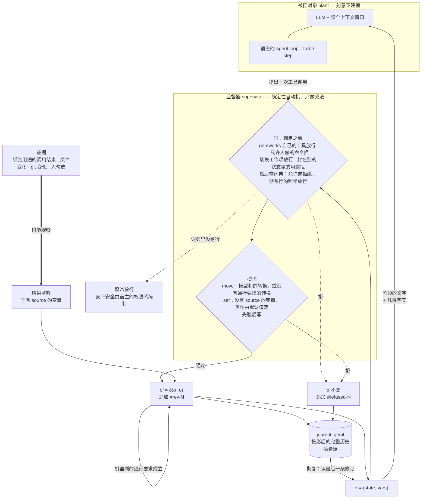

# 进阶：固化流程是怎么管住模型的

[← 回到 README](../README.zh.md)

一份**用 GEML 写的流程**——一台状态机——决定 agent 此刻能走哪些转换、能写哪些
变量、哪些工具属于它所在的阶段。状态声明**用途**（`edit`、`test`、`deploy-prod`：
作者自己起的词）；流程旁边的一本**工具词典**把每个用途绑到本项目的具体工具上，流程声明为
**封路用途**（`rules`）的用途只在声明了它的状态里能用。**证据**——一次测试的退出码、一个 pull request、磁盘上
的一个文件、人的一次勾选——由宿主观测到的事实写入，从不凭模型一句话。每次变化先校验
后落地，并追加进一本**带哈希链的 journal**——journal 本身就是一份普通 GEML 文档，
可读、可寻址、可 diff、可校验。

这不是对 agent 的建模，而是一个 Ramadge–Wonham 意义上的**监督器**：被控对象是
LLM 加它的整个上下文，任意、不建模；监督器在旁边并行运行，只做一件事——把事件
从"接下来可能发生"里拿掉。它买到的是**安全性质**：某些动作序列不可能发生。不是
收敛，也不是对模型行为的预测。



各宿主只提供**机制**；上面每一个**判断**都只有一份（`src/core/supervisor.ts`），
谁也没有第二份拷贝——Claude Code 上它跑在打包好的 CLI 里，插件经一座桥去问它：

| | DeepSeek Harness | pi agent | Claude Code |
|---|---|---|---|
| 调用之前的闸 | `tools/pre-execute`：允许，或带理由拒绝 | `tool_call` → `{ block, reason }`，或什么都不返回 | `tool.call` hook：快路径按手上那份策略判，CLI 经桥裁决并记录；首选工具的问题用 `$.ui.ask` 问人，答案写进 `tools.geml`，词典的默认参数补上调用没写的 |
| 动词的形状 | `move` 与 `set` 按状态重注册：`move` 的枚举就是模型能走的转换，`set` 的参数就是它能写的变量；`status` 一直在 | 每会话只注册一次：`move` 的枚举是流程里的全部目标；不是当前状态出边的 move 被拒并记录 | schema 固定不变（`to` 是任意字符串）；不是出边的 move 被拒 |
| 人的转换 | web GUI 右侧栏的看板：人的转换（标了 `approval` 的也在）、勾变量、暂停；会话的 journal 不是 CLI 的，终端里的 `gemworks advance` 到不了它 | 还没有：会话的 journal 不是 CLI 的，标了 `approval` 的转换在那里没人能走 | 看板，或终端里的 `gemworks advance`；`gemworks mark` 勾一个 source 是人的变量 |
| 证据 | `tool`，来自 `tools/result`：结果报了退出码就用它，否则出错算 1、正常算 0 | `tool`，来自 `tool_result`：出错算退出码 1，正常算 0 | `tool`、`file`、`git`、`human` 四种，经 workspace |
| σ 怎么到模型眼前 | 一段提示词 section + 每步一次的 context 块 | 系统提示词，每个用户回合重建一次 | 让阶段变了的那次调用，结果后面附上新的 `#current`；否则随下一次提交 |
| journal | `<journalDir>/<session>.geml` | 同一个文件，外加每块一条会话条目——分叉出去的会话就是靠它继承整条链的 | `.geml/journals/<工作项>.geml`，每个工作项一本，与 CLI 共用 |
| `.geml/context.geml` | 不写 | 不写 | 写 |

监督器的状态是 `σ = (state, vars)`，允许集一行说完：

> `A(σ)` = 全部工具，去掉绑到本状态没声明的封路用途的、以及词典在本状态拒绝的，⋃ 由模型判
> 或没有通行要求的那些出边，⋃ 没有 `source` 的变量。

绑到本状态没声明的封路用途的工具被拒，词典在本状态拒绝的工具被拒，其余照常放行。

## 状态

| | |
|---|---|
| 现在可用 | 流程格式，建在 `geml-statechart/v1` 上（没有自己的词汇表）；核心库（流程载入与静态检查、工具词典、按来源分的证据、哈希链修订、journal 渲染/读取/校验、监督器、Stagehand、工作项、backlog 表）；workspace——对一个项目一次只做一个加锁的操作；`gemworks` CLI；四份内置的固化流程（`coding`、`dev`、`matter`、`video`），各带自己的词典；Claude Code 插件（输入框上方的状态带、看板、`/gemworks`，以及模型可调的工具：固化流程的 `status`、`move`、`set`，工作循环的 `work`、`note`、`practice`、`propose`、`ask`、`artifact`、`rule`）；给只接 MCP 的宿主用的 `gemworks mcp`；Codex 与 Antigravity 的 hooks，配一页 GEML 看板 `.geml/board.geml`；两个宿主适配器——DeepSeek Harness `0.2.0-rc.2` 的 Cordis 插件（看板是其 web GUI 右侧栏的一个标签页）与 pi agent `1.x` 的扩展。 |
| 不接模型也测过 | 每一道闸在两个适配器宿主上各测一遍：DSH 侧用 `dsh-agent-loop-testkit` 起真 agent，pi agent 侧用一个按它自己的管线顺序、并且用它自己的参数校验器跑的替身。Claude Code 插件：hooks 模块在 `claude plugin test` 下按真实事件顺序跑，桥接由脚本应答；桥接本身经打包后的 CLI 在临时 git 仓库里测，`gh` 用替身；快路径被钉在 workspace 会拒绝、会记录、会询问的范围上。接真模型跑一遍是手工步骤，见下。 |
| 还不是每个宿主都有 | 来自文件、git 与人的证据，以及当前阶段的上下文文档（`.geml/context.geml`），都经由 workspace 运行。Claude Code 插件把每一次工具调用都交给它，Codex 的 hooks 信任之后也一样，所以四种来源在那里都读得到。只接 MCP 的宿主（`gemworks mcp`：Gemini CLI、Grok、没信任 hooks 的 Codex……）上看不到任何工具调用：`tool` 证据永远写不了，什么都不拒，模型调用 `status` 时它才重新读一遍 git 和文件变量。两个宿主适配器是每个会话一本 journal，只写 `tool` 证据；pi agent 上标了 `approval` 的转换还没人能走。 |
| 还没实测 | 在 DeepSeek Harness 上按状态重注册 `move` 与 `set` 对提示词缓存的代价。 |
| bundle 里还带着 | GEML MCP server，以及 `host-skills/` 下的四个技能——`geml`、`geml-code-graph`、`gemworks-mcp` 与 `split-session`（见[安装](hosts.zh.md#安装)）。 |

设计：[`docs/design/specs/2026-10-11-gemworks-design.md`](../docs/design/specs/2026-10-11-gemworks-design.md)。
流程格式与运行时规则：[`spec/workflow_CN.md`](../spec/workflow_CN.md)；
状态机格式：GEML 仓库里的 [`spec/profiles/geml-statechart/`](https://github.com/geml-spec/geml/blob/main/spec/profiles/geml-statechart/geml-statechart-profile_CN.md)。

## 一份流程

下面是 `gemworks init` 写出来的那份（节选）——管一次 coding 会话的那份。一份流程就是
一个 `diagram` 块，正文是一台状态机：

```geml
=== meta
title   = "Coding workflow"
profile = "geml-statechart/v1"
===

=== diagram {#flow format=geml-statechart caption="Coding workflow"}
{
  "initial": "explore",
  "states": {
    "explore":   { "title": "Explore",   "description": "Read the code before proposing anything; record goal and touched, then move to plan.", "prompt": "#explore" },
    "plan":      { "title": "Plan",      "description": "Write the plan down before touching a file.", "prompt": "#plan" },
    "implement": { "title": "Implement", "description": "Make the change. Editing is possible here and nowhere else.", "prompt": "#implement", "rules": ["edit"] },
    "verify":    { "title": "Verify",    "description": "Run the command; its exit status is the evidence.", "prompt": "#verify", "rules": ["test"] },
    "review":    { "title": "Review",    "description": "Hand back to the person.", "prompt": "#review" },
    "done":      { "title": "Done", "final": true }
  },
  "vars": {
    "goal":       { "default": "", "note": "What this change is supposed to achieve, in one sentence" },
    "touched":    { "default": "", "note": "The files this change edits, space separated" },
    "plan":       { "default": "", "note": "The steps, written before any file is touched" },
    "command":    { "default": "", "note": "The command that decides whether this works, e.g. npm test" },
    "tests-pass": { "default": false, "source": { "tool": "test" } }
  },
  "transitions": [
    { "from": "explore",   "to": "plan",      "guard": "goal and touched are recorded" },
    { "from": "plan",      "to": "implement", "guard": "plan and command are recorded" },
    { "from": "implement", "to": "verify",    "note": "The edit is made; go run the command." },
    { "from": "verify",    "to": "implement", "guard": "the command failed, or the change is not finished", "actions": [{ "reset": ["tests-pass"] }] },
    { "from": "verify",    "to": "review",    "guard": { "properties": { "tests-pass": { "const": true } } } },
    { "from": "review",    "to": "done",      "approval": true },
    { "from": "review",    "to": "implement", "guard": "the person asked for changes", "actions": [{ "reset": ["tests-pass"] }] }
  ]
}
===

## Explore {#explore}

Read the code before proposing anything. …
```

还有项目的 `.geml/tools.geml`——把用途绑到本项目工具上的那本词典，项目的所有流程共用一份：

```geml
=== table {#tools}
| tool             | for  | allow | deny | default | params |
|------------------|------|-------|------|---------|--------|
| Read             |      | *     |      |         |        |
| Grep             |      | *     |      |         |        |
| Edit             | edit |       |      | yes     |        |
| Write            | edit |       |      |         |        |
| Bash(npm test)   | test |       |      | yes     |        |
| Bash(cargo test) | test |       |      |         |        |
===
```

状态依次是 `#explore → #plan → #implement → #verify → #review → #done`。
三种通行要求，三种判断者：对条件变量的一个对象（JSON Schema 的子集）由机器判，这样的
转换在通行要求成立的那一刻自己走——`tests-pass` 写成 true，`#verify` 就到了
`#review`；一句话由模型判，模型认为成立时用 `move` 走；`approval: true` 由人判，在
看板上或用 `gemworks advance` 走，模型从来走不了。通行要求对谁推进都一样生效。带
`source` 的变量是证据：`tests-pass` 由绑到用途 `test` 的一次调用的退出码写入，`set`
拒绝写它。没有 `source` 的变量归模型 `set`，类型由默认值定。`{ "elapsed": "PT2H" }` 读时钟：本阶段停留满这么久即 true，
读它的通行要求就是超时。`done` 标了 `final`：进了它工作项就关闭——没有出边，
证据不再过期——人用 `gemworks rollback` 才能重开。

状态在 `rules` 里声明的用途只在声明了它的状态里能用；写在 `tools` 里的用途哪里都能跑，
只是它的证据只在声明了它的状态里算数。`#implement` 把 `edit` 声明为封路用途，所以 `Edit` 与 `Write`
在那里能跑，在别处都被拒（`Write is edit, which is used only in #implement; the
workflow is in #explore`）；`#verify` 声明了 `test`，所以 `npm test` 只在那里能跑。
词典里没有行的工具照常放行。搬到 Rust 项目，同一份流程把 `test` 绑到 `cargo test`，其余一字不改。这些都不是
写在提示词里、模型可能忘掉或者跟你争的规矩：调用在执行前被拒，拒绝记进 journal。

`geml check` 像验任何 GEML 一样验这份文档；`gemworks check` 再加上状态机自己的检查和
流程的检查（`flow-*`），并对照流程读词典。`geml get .geml/workflows/coding.geml '#flow'`
读这个块；`geml … --to md` 把它投影成 GitHub 能画的 Mermaid 状态图，HTML 渲染器和
viewer 直接画它；`.gemlhistory` 给它记版本。

`gemworks init` 把完整的那份写进 `.geml/workflows/coding.geml` 并设为当前流程；
`--template dev` 写[开发流程](workflows.zh.md#开发流程)那份从分支到 production 的流程，
`--template video` 写[视频流程](workflows.zh.md#视频流程)那份一集一集的流程。

## 它不做什么

它只约束它建模了的那部分世界。下面这些都不是疏漏：

- **回滚恢复的是声明变量与控制状态，不是外部副作用。** journal 能把 `approved`
  拨回 `false`，拨不回已经打出去的退款。补偿要流程作者自己写。
- **工具门控不是沙箱。** 它决定模型在某个状态里能调哪些工具；被放行的 `bash`
  里干了什么，那是 harness 沙箱的事。两层互补。
- **词典读的是命令行，不是命令做了什么。** `Bash(…)` 键是对命令行的一个模式：经由
  词典里没有行的启动器、变量或脚本跑的部署绕得过它，`--dry-run` 的部署按它写的那个
  部署算。把你项目真正会跑的写法写成行。
- **恢复恢复的是状态，不是对话。** 几百字节带回"在哪、接下来能做什么"；对话由
  harness 按它自己的规则重放。
- **一道闸的强度按宿主最弱的那个机制算**，上面那张表写的就是哪一个。pi agent 上
  `move` 的枚举是流程里的全部目标，而不是只有 `σ` 当下的那几条出边，因为 pi agent 的
  工具不能在会话中途重注册；这一步仍然会被拒——晚一步——并且照样记进 journal。

因此适用面是**顺序可枚举的事**——注意这跟「内容可枚举」不是一回事。审批、KYC、
工单分级是容易的那一类：步骤本身事先就知道。

写代码是有意思的那一类。agent 会写出什么，不可枚举，也不该枚举——但**阶段**是可
枚举的：先读再想，先有计划再动文件，先真跑测试再说测试过了。自带的 coding 流程
建模的就是这个，不再细。细到一个文件一个状态、一个函数一个状态，那就是失败模式：
把模型的判断力花在填表上，而且什么都没买到——因为那些步骤的先后本来就不承载意义。
一个步骤排在哪儿无所谓，它就不配拥有一个状态。

## 在一个项目上开始用

用 pi agent 在一个项目上跑一条固化流程，从零到跑起来，五分钟：`gemworks` 和它依赖的
解析器 `@geml/geml` 都从 npm 装。

**依赖**：Node 22 以上，加一个 harness——[pi agent](https://pi.dev)
（`npm install -g @earendil-works/pi-coding-agent`）或者 DeepSeek Harness；再加
你给 harness 配的模型 key——监督器不碰它。

`pi install` 收的是包**目录**、`npm:` 源或者 `git:` 源，**不是 `.tgz`**。喂它一个
tarball，它会照单收下、写进 `settings.json`，然后此后每次启动都报
`Unknown file extension ".tgz"`。已经踩了的话，`pi remove <同一个路径>` 就好。

```sh
# 1. CLI，从 npm 装
npm install -g gemworks                           # gemworks 命令（简写 gwx）

# 2. 同一个包装进 pi agent：它的扩展和技能
pi install npm:gemworks

# 3. 到你要干活的仓库里，开一个自己的分支
cd ~/code/my-project
git switch -c feat/my-change
gemworks init                                     # .geml/workflows/coding.geml，设为默认流程
gemworks check .geml/workflows/coding.geml        # 0 表示它能载入
gemworks status                                   # feat/my-change · #explore

# 4. 干活
pi "把 test/user.test.ts 里那个挂掉的用例修好"
```

第 4 步之后就是一次普通会话，唯一的差别是：模型按状态被告知这个阶段是干什么的、有
哪些工具。自带的词典写的是 Claude Code 写文件的工具名（`Edit`、`Write`）和 Codex 的
`apply_patch`；pi agent 的是 `edit`、`write`，对不上。词典里没有行的工具照常放行。（pi 的
`bash` 按 `Bash(…)` 键读，所以 `Bash(npm test)` 在那里本来就算 `test`。）所以先把这几行写好：
`edit | edit`、`write | edit`，测试命令没有行的话再加一行，比如 `Bash(node test.mjs) | test`——
此后在 `#explore` 里改文件会在执行前被拒，理由用人话给出，并且这条拒绝进 journal。没写这几行，
pi 的改文件不受封路约束。（`Edit` 已经是这个用途的首选：给 `edit` 再写一个 `default` = `yes`
是错误。）

pi agent 按会话写这本 journal，落在 `<会话目录>/gemworks/<session>.geml`。
`gemworks export <journal> --to md` 读它，`gemworks verify` 验它。在终端里跑的
`gemworks status`、`mark`、`advance` 作用于分支自己的 journal，
`.geml/journals/<branch>.geml`。

**`.geml/workflows/coding.geml` 与 `.geml/tools.geml` 就是全部配置，按你的项目改它们。**
状态和每个状态声明的用途、变量和每个变量从哪读、通行要求；以及你的哪个工具是哪个
用途——全在里面。自带这份做了四个约束：没计划不许改文件、改文件时不许执行命令、
没有真实测试结果不许说完成、最后一步交给人。四条都是强制的：前两条是因为 `edit` 是
`#implement` 的封路用途、`test` 是 `#verify` 的封路用途，第三条靠一条机器判的通行要求，读的是
模型写不了的证据，第四条靠一条标了 `approval` 的转换。你的项目要别的顺序，那是改一段
文本，不是改代码。

### 不用 API key，先把整条路看一遍

在本仓库的检出里：

```sh
npm install && npm run build
npm run walkthrough
```

它会起一个**真的** pi agent 会话，对着一个临时项目（里面有个挂掉的测试），由一个
脚本化的模型（`examples/scripted-model.js`）驱动，所以不需要任何凭证，而且每次输出
一样。除了模型，其它全是真的——pi agent 自己的循环、它的工具管线，`bash` 是真跑的，
写下 `tests-pass` 的是真实的退出码。它会打印每一步模型试了什么、流程拒绝的那几次调用
后来怎样了、以及最后那本 journal；要是有一次被拒的调用跑了，它以退出码 1 结束。想判断
这种约束形态是不是你要的，这是最短的路。
